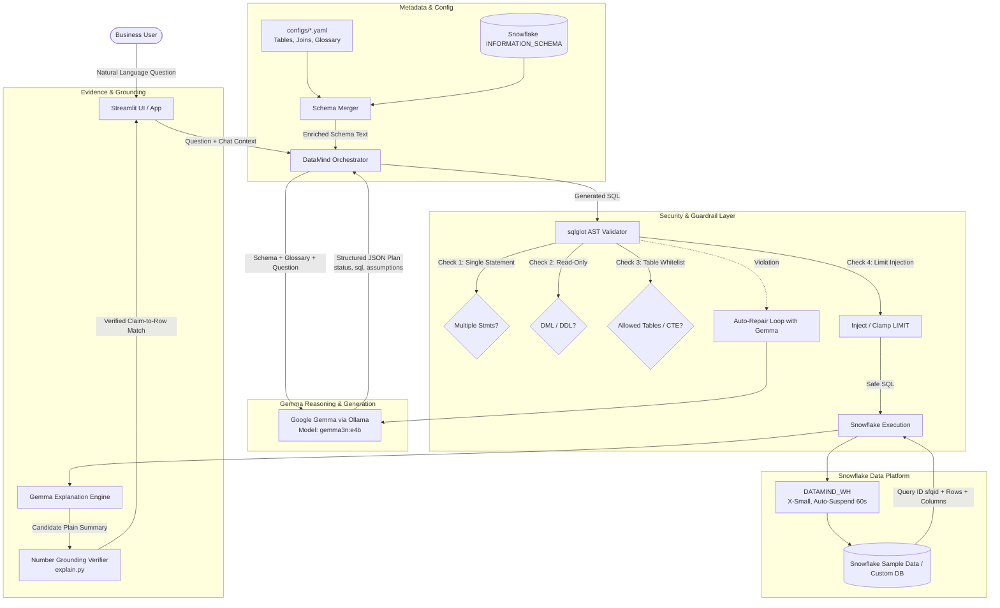

# DataMind Architecture & System Design

DataMind is a conversational data exploration and analytics engine that translates everyday natural language questions into data-grounded answers. Built for **PS1: Talk to Your Data**, DataMind integrates **Snowflake** (as the analytical data warehouse) with **Google Gemma** (as the reasoning and generation model), reinforced by a deterministic AST guardrail layer and claim-to-row verification.

---

## 1. High-Level System Architecture

---

## 2. Core Architectural Components

### 2.1 Configuration Layer (`configs/*.yaml` + `pydantic`)
Instead of hardcoding table names or business definitions into prompt strings, DataMind is **100% configuration-driven**:
- **Dataset Agnostic**: Switching datasets requires selecting a different YAML file in the UI sidebar without modifying any Python code.
- **Business Glossary**: Encodes domain definitions (e.g. `revenue = SUM(L_EXTENDEDPRICE * (1 - L_DISCOUNT))`), ensuring Gemma uses organizational definitions.
- **Join Graph**: Explicitly provides canonical join relationships to eliminate invalid join attempts.

### 2.2 Schema Discovery & Introspection (`datamind/schema.py`)
DataMind inspects Snowflake's live `INFORMATION_SCHEMA.COLUMNS` at startup:
- Retrieves exact live column names and data types directly from Snowflake.
- Merges live types with business descriptions provided in the YAML configuration.
- Automatically handles schema evolution when tables are added or column types change.

### 2.3 Gemma LLM Client (`datamind/gemma_client.py`)
Separates LLM inference from data storage:
- Connects to local Ollama (`http://localhost:11434/api/chat`) running Google Gemma (`gemma3n:e4b`).
- Temperature is hardcoded to `0.0` for deterministic, factual SQL generation.
- Enforces strict JSON output (`status`, `sql`, `assumptions`, `clarification`).

### 2.4 Deterministic Guardrails (`datamind/validator.py`)
To prevent data leaks, SQL injections, or accidental mutations:
1. **Single Statement Enforcement**: Parses AST using `sqlglot`; rejects semicolon-chained statements immediately.
2. **SELECT-Only Verification**: Blocks all DML (`INSERT`, `UPDATE`, `DELETE`, `TRUNCATE`) and DDL/Admin operations (`DROP`, `ALTER`, `CREATE`, `GRANT`, `REVOKE`).
3. **Table Whitelist Verification**: Extracts all table references and verifies each belongs to the authorized whitelist or a defined Common Table Expression (CTE).
4. **Automatic Limit Injection**: Clamps query output to `max_rows` (default 500) to protect network bandwidth and warehouse memory.

### 2.5 Auto-Repair Loop (`datamind/agent.py`)
If a query fails AST validation or Snowflake raises an execution error:
- The exact error diagnostics are fed back to Gemma.
- Gemma corrects the SQL up to 2 retries before escalating to a user error.
- Guarantees high question-to-answer conversion without user frustration.

### 2.6 Verifiable Grounding & Explainability (`datamind/explain.py`)
Addresses the core PS1 requirement for **traceability and trust**:
- **Plain Language Explanation**: Gemma generates human-readable steps ("how") listing tables queried, filters applied, and metrics aggregated.
- **Numbers Grounding Check**: Regex and numeric float verification scans the natural language explanation and verifies that every single number quoted is backed by the retrieved Snowflake rows.
- If an unverified number appears, a warning badge is prominently displayed to the user.
- Without Snowflake credentials, the app uses placeholder rows and labels every response as simulated; checks against those rows are not presented as verification of real database results.

---

## 3. Snowflake Least-Privilege & Cost Architecture

- **Role-Based Access Control**: All DataMind operations execute under the dedicated `DATAMIND_READONLY` role.
- **Warehouse Efficiency**: Utilizes `XSMALL` warehouse size with `AUTO_SUSPEND = 60` seconds and `AUTO_RESUME = TRUE`. Queries suspend immediately when idle, conserving free trial credits.
- **Auditing & Provenance**: Every query response surfaces the native Snowflake Query ID (`sfqid`), allowing administrators to inspect exact query execution history in Snowflake Snowsight.

---

## 4. PS1 Rubric Alignment

| Criterion | Points | DataMind Implementation & Evidence |
|---|---|---|
| **1. Correctness & Grounding** | 20 | 35-question golden benchmark (`eval/golden_tpch.yaml`) tested against ground truth SQL. |
| **2. Natural-Language-to-Data** | 10 | Context-aware orchestrator handling synonyms, aggregations, multi-table joins, and conversation history. |
| **3. Evidence & Traceability** | 15 | Snowflake Query ID, executed SQL display, result table, CSV download, and claim-to-row numeric verification. |
| **4. Snowflake Integration** | 15 | Native connector, `INFORMATION_SCHEMA` introspection, `DATAMIND_READONLY` least privilege, `DATAMIND_WH` auto-suspend. |
| **5. Gemma Integration** | 12 | Central task execution: question parsing, SQL synthesis, repair iteration, and row explanation via local Ollama. |
| **6. Ambiguity & Guardrails** | 12 | Clarification states, unsupported refusal, empty result messaging, and sqlglot AST read-only enforcement. |
| **7. Reusability & Adaptability** | 8 | Tested against 2 datasets (`configs/tpch.yaml` and `configs/owid.yaml`) via config changes without code rewrites. |
| **8. Practical UX & Relevance** | 8 | Streamlit web UI with 5 dedicated inspection tabs, interactive Plotly charts, and example queries. |
